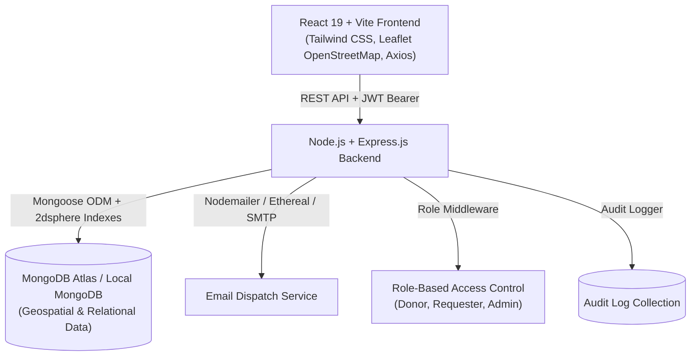

# LifeFlow — Emergency Blood Donation & Donor Matching System

A full-stack, production-ready MERN web application engineered to coordinate urgent blood donation requests with registered potential donors using MongoDB 2dsphere geospatial radius queries, real-time availability tracking, and automated multi-channel notifications.

> **Clinical & Legal Disclaimer:**  
> LifeFlow is a donor discovery and coordination network. It **does not** replace hospitals, clinical laboratories, blood banks, or medical compatibility testing. Matching blood groups does not guarantee biological compatibility. All blood transfusions, donor eligibility screenings, and cross-matching must be verified at certified medical facilities.

---

## 👥 Teammates Quickstart & Onboarding Guide

Welcome team! This repository is organized as a clean **monorepo** containing both the React frontend (`client/`) and Express backend (`server/`). Follow these exact steps to get up and running in under 3 minutes:

### ⚡ 3-Minute Setup

```bash
# 1. Clone repository (once pushed to GitHub)
git clone <your-github-repo-url>
cd mini-project

# 2. Install backend dependencies
cd server
npm install

# 3. Create server/.env (or copy from server/.env.example)
# Default values will connect to local MongoDB at mongodb://127.0.0.1:27017/blood_donation_db
copy .env.example .env

# 4. Seed database with synthetic demo accounts & hospital requests
node src/utils/seed.js

# 5. Run automated test suite to verify everything passes
node tests/run-tests.js

# 6. Install frontend dependencies
cd ../client
npm install
copy .env.example .env

# 7. Start both servers
# In Terminal 1 (from server directory):
node src/server.js       # Starts on http://localhost:5000

# In Terminal 2 (from client directory):
npm run dev             # Starts on http://localhost:5173
```

---

## 📂 Project Structure & Directory Map

```
mini-project/
├── client/                           # Frontend React Application
│   ├── public/                       # Static public assets (icons, favicon)
│   ├── src/
│   │   ├── components/               # Reusable UI Components
│   │   │   ├── BloodGroupBadge.jsx   # Styled badge with blood drop icon
│   │   │   ├── Footer.jsx            # Disclaimer and platform metadata
│   │   │   ├── LeafletMap.jsx        # OpenStreetMap Leaflet component
│   │   │   ├── Modal.jsx             # Accessible dialog modal
│   │   │   ├── Navbar.jsx            # Responsive navigation & availability toggle
│   │   │   ├── ProtectedRoute.jsx    # Role-based route guard
│   │   │   └── StatusBadge.jsx       # Request status and urgency badges
│   │   ├── context/
│   │   │   ├── AuthContext.jsx       # User state, JWT storage, role helpers
│   │   │   └── NotificationContext.jsx # Real-time unread alert polling
│   │   ├── pages/                    # 10 Role & Public Pages
│   │   │   ├── AdminDashboard.jsx    # DB analytics, donor verify queue, audit logs
│   │   │   ├── CreateRequestPage.jsx # New emergency request with hospital presets
│   │   │   ├── DonorDashboard.jsx    # Live availability switch & matching requests
│   │   │   ├── DonorProfilePage.jsx  # GPS coords, preferences & deactivation
│   │   │   ├── LandingPage.jsx       # Live feed, 1-click logins, compatibility guide
│   │   │   ├── LoginPage.jsx         # Sign in with 1-click demo accounts
│   │   │   ├── NearbyDonorsPage.jsx  # Radius slider, radar map, multi-contact tool
│   │   │   ├── NotificationCenterPage.jsx # Inbox for emergency alerts
│   │   │   ├── RegisterPage.jsx      # Donor vs Requester registration
│   │   │   └── RequestDetailsPage.jsx# Coordination tracking & lifecycle state machine
│   │   ├── services/                 # Axios API services
│   │   │   ├── adminService.js
│   │   │   ├── api.js                # Base axios instance with JWT interceptor
│   │   │   ├── authService.js
│   │   │   ├── donorService.js
│   │   │   ├── notificationService.js
│   │   │   └── requestService.js
│   │   ├── App.jsx                   # React Router routing configuration
│   │   ├── index.css                 # Tailwind CSS v4 styling & theme setup
│   │   └── main.jsx                  # React application entrypoint
│   ├── vite.config.js                # Vite configuration with /api proxy to port 5000
│   └── package.json
│
├── server/                           # Backend Node.js / Express API
│   ├── src/
│   │   ├── config/
│   │   │   └── db.js                 # Mongoose connection with autoIndex
│   │   ├── controllers/              # REST Request Controllers
│   │   │   ├── adminController.js    # Database aggregate metrics & verifications
│   │   │   ├── authController.js     # Register, login, /me, deactivation
│   │   │   ├── donorController.js    # Availability, profile, history, nearby search
│   │   │   ├── notificationController.js # Mark read, pagination
│   │   │   ├── requestController.js  # Request lifecycle state machine
│   │   │   └── responseController.js # Accept/decline responses
│   │   ├── middleware/
│   │   │   ├── auth.js               # authenticate & authorize(...roles)
│   │   │   ├── errorHandler.js       # Centralized error formatter
│   │   │   └── rateLimiter.js        # Express-rate-limit protection
│   │   ├── models/                   # Mongoose Schemas & 2dsphere Indexes
│   │   │   ├── AuditLog.js           # Administrative action audit trail
│   │   │   ├── BloodRequest.js       # Hospital location, units, urgency, status
│   │   │   ├── DonorProfile.js       # BloodGroup, 2dsphere location, availability
│   │   │   ├── DonorResponse.js      # Unique compound index {request, donor}
│   │   │   ├── Notification.js       # In-app and email delivery status
│   │   │   └── User.js               # Name, email, hashed password, role
│   │   ├── routes/                   # Express Routers
│   │   │   ├── adminRoutes.js
│   │   │   ├── authRoutes.js
│   │   │   ├── donorRoutes.js
│   │   │   ├── notificationRoutes.js
│   │   │   ├── requestRoutes.js
│   │   │   └── responseRoutes.js
│   │   ├── services/
│   │   │   ├── auditService.js       # Action logger
│   │   │   ├── matchingService.js    # Rule-based $geoNear geospatial matching
│   │   │   └── notificationService.js# Nodemailer + Ethereal email dispatch
│   │   ├── utils/
│   │   │   └── seed.js               # Synthetic test data generator
│   │   ├── app.js                    # Express app configuration
│   │   └── server.js                 # HTTP listener entrypoint
│   ├── tests/
│   │   └── run-tests.js              # 18 automated integration & unit tests
│   └── package.json
│
├── postman_collection.json           # Pre-configured Postman API collection
├── package.json                      # Root workspace scripts
└── README.md
```

---

## 1. System Architecture & Tech Stack



- **Frontend:** React 19, Vite, Tailwind CSS v4, Leaflet & React-Leaflet, Lucide Icons, React Router v7, Axios.
- **Backend:** Node.js, Express.js, Mongoose 8+, JWT (JSON Web Tokens), bcryptjs, Helmet, Morgan, Express-Rate-Limit.
- **Geospatial Engine:** MongoDB GeoJSON `Point` coordinates (`[longitude, latitude]`) with `2dsphere` indexes and `$geoNear` aggregation.
- **Notifications:** Nodemailer with automated Ethereal development mailboxes and custom SMTP configuration.
- **Maps:** Leaflet with OpenStreetMap tiles (custom sharp HTML DivIcons for collection points and donor proximity pins).

---

## 2. Implemented Core Features

| Feature | Implementation Highlights |
|---|---|
| **1. Registration & Auth** | Secure password hashing via `bcryptjs`, JWT bearer authentication, session validation, input sanitization, and account deactivation. |
| **2. Donor Profiles** | Blood group categorization, GeoJSON coordinates, live availability toggle, contact preferences, and clinical verification tracking. |
| **3. Emergency Requests** | Blood group, required units, hospital location, urgency levels (`low`, `medium`, `high`, `critical`), and required-by deadlines. |
| **4. Rule-Based Matching** | Multi-tier matching: blood group compatibility matrix, `availabilityStatus: true` filter, configurable radius (5–100 km), distance ranking via `$geoNear`. |
| **5. Notifications** | In-app notification center and email notifications sent on request creation, direct invitations, and donor responses. |
| **6. Request Tracking** | Strict backend-validated lifecycle state machine: `open` &rarr; `donors_contacted` &rarr; `awaiting_responses` &rarr; `coordination_in_progress` &rarr; `fulfilled` (or `cancelled`). |
| **7. Map Interface** | Interactive Leaflet OpenStreetMap with search radius rings, hospital markers, and privacy-preserving donor proximity circles. |
| **8. Real-Time Analytics** | Live MongoDB aggregations computing fulfillment rates, response times, blood group distributions, and an administrative audit trail. |

---

## 3. User Roles & Access Control (RBAC)

1. **Donor (`donor`)**
   - Manage availability status with 1-click live toggle.
   - View relevant emergency requests matching their blood group in their vicinity.
   - Accept or decline emergency requests with optional notes.
   - View donation history and notifications.
   - Update location or deactivate profile.

2. **Requester (`requester`)**
   - Create emergency blood requests for hospitals and collection centers.
   - Discover nearby available donors using interactive radius slider and map.
   - Send emergency contact invitations to matched donors.
   - Track donor responses (contacted, accepted, declined).
   - Coordinate transfusion and transition request statuses.

3. **Blood Bank Administrator (`admin`)**
   - View live operational dashboard metrics computed from actual database records.
   - Review and verify donor eligibility with medical screening notes.
   - Manage reported or duplicate blood requests.
   - Inspect the immutable audit trail of administrative actions.

---

## 4. Quick Demo Accounts

Pre-seeded synthetic demo accounts ready for immediate testing:

| Role | Email | Password | Details |
|---|---|---|---|
| **Administrator** | `admin@bloodnetwork.org` | `admin123` | Dr. Evelyn Reed (Blood Bank Admin) |
| **Requester** | `dr.sharma@citycare.org` | `requester123` | Dr. Rajesh Sharma (City Care Hospital) |
| **Requester** | `sarah.requester@metrohealth.org` | `requester123` | Metro Emergency Trauma Center |
| **Donor (O+)** | `rahul.verma@example.com` | `donor123` | Rahul Verma (Central Bangalore, Available) |
| **Donor (A+)** | `priya.nair@example.com` | `donor123` | Priya Nair (Indiranagar, Available) |
| **Donor (O-)** | `sneha.rao@example.com` | `donor123` | Sneha Rao (Universal Donor, Jayanagar) |

---

## 5. Automated Testing

Run the automated integration and unit test suite verifying authentication, RBAC restrictions, geospatial queries, request lifecycle state transitions, and database aggregations:

```bash
cd server
node tests/run-tests.js
```

**Expected Result:**
```
======================================
TEST SUMMARY: 18 PASSED, 0 FAILED
======================================
```

---

## 6. REST API Documentation

### Authentication
- `POST /api/auth/register` — Register a new donor or requester.
- `POST /api/auth/login` — Authenticate and receive a signed JWT token.
- `GET /api/auth/me` — Retrieve the currently authenticated user's profile.
- `POST /api/auth/deactivate` — Soft-deactivate an account and set availability to false.

### Donors
- `GET /api/donors/me` — Get donor profile (Donor only).
- `PATCH /api/donors/me` — Update donor profile and address (Donor only).
- `PATCH /api/donors/availability` — Quick toggle availability boolean (Donor only).
- `GET /api/donors/requests` — Get relevant active requests matching blood group (Donor only).
- `GET /api/donors/history` — Get completed donation history (Donor only).
- `GET /api/donors/nearby` — Geospatial discovery matching donors by coordinates & radius (Requester/Admin).

### Blood Requests
- `POST /api/requests` — Create an emergency blood request (Requester/Admin).
- `GET /api/requests` — List blood requests with search/status/urgency filters.
- `GET /api/requests/:id` — Get single request with hospital location and responses.
- `PATCH /api/requests/:id/status` — Validated state transition (`open` &rarr; `donors_contacted` &rarr; `awaiting_responses` &rarr; `coordination_in_progress` &rarr; `fulfilled`).
- `POST /api/requests/:id/cancel` — Cancel active request with closure reason.
- `POST /api/requests/:id/contact` — Dispatch invitations to matched donors.
- `GET /api/requests/:id/matched-donors` — Discover matched donors for a specific request.

### Donor Responses
- `POST /api/requests/:id/responses` — Donor accepts, declines, or marks unavailable (Donor only).
- `GET /api/requests/:id/responses` — View response roster for a request (Requester/Admin).

### Notifications
- `GET /api/notifications` — Fetch user notifications with unread count.
- `PATCH /api/notifications/:id/read` — Mark notification as read.
- `PATCH /api/notifications/read-all` — Mark all user notifications as read.

### Administration
- `GET /api/admin/dashboard` — Live aggregate statistics computed from database.
- `GET /api/admin/donors` — List donors for administrative clinical review.
- `PATCH /api/admin/donors/:id/verify` — Verify or reject donor eligibility with notes.
- `GET /api/admin/audit-logs` — Paginated audit logs of administrative actions.

---

## 7. Postman Collection

Import `postman_collection.json` located in the root repository directly into Postman to run pre-configured requests against all endpoints with environment variables.

---

## 8. Deployment Instructions

### Database (MongoDB Atlas)
1. Create a free cluster on [MongoDB Atlas](https://www.mongodb.com/cloud/atlas).
2. Create a database user and whitelist network access (`0.0.0.0/0`).
3. Obtain connection URI and set as `MONGODB_URI`.

### Backend (Render / Railway)
1. Link your GitHub repository to Render as a **Web Service**.
2. Root directory: `server`.
3. Build command: `npm install`.
4. Start command: `node src/server.js`.
5. Environment variables: `NODE_ENV=production`, `MONGODB_URI`, `JWT_SECRET`, `CLIENT_URL`.

### Frontend (Netlify / Vercel)
1. Link your GitHub repository to Netlify.
2. Base directory: `client`.
3. Build command: `npm run build`.
4. Publish directory: `dist`.
5. Environment variable: `VITE_API_URL=https://your-render-backend.onrender.com/api`.

---

## 🚀 Pushing to GitHub (For Team Leads & Collaborators)

To push this codebase to your team's GitHub repository:

```bash
# 1. Create a new empty repository on GitHub (e.g., blood-donation-system)
# 2. In your terminal at the project root:
git remote add origin https://github.com/<your-username>/<your-repo-name>.git

# 3. Ensure branch is main
git branch -M main

# 4. Push code
git push -u origin main
```

### Team Branching Strategy
- `main`: Protected production-ready branch.
- `feature/<feature-name>`: Branches for new enhancements (e.g. `feature/sms-twilio`, `feature/hospital-inventory`).
- Create Pull Requests (PRs) into `main` after verifying with `node tests/run-tests.js` and `npm run build`.
